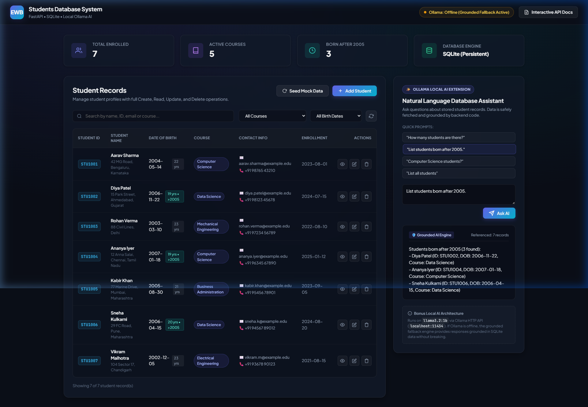

# Students Database CRUD Application & Local AI Assistant

> **EWB Edu Tech Pvt. Ltd. | Python Backend Development Internship Project**  
> **Project Type:** Individual Backend Development Project  
> **Technology Stack:** Python 3.10+, FastAPI, SQLite, SQLAlchemy, Pydantic v2, Ollama (Local AI)



---

## 📌 Project Overview

This project is a production-ready Python backend application built to manage student records with persistent storage and comprehensive **Create, Read, Update, and Delete (CRUD)** capabilities. 

In addition to fulfilling all core mandatory backend requirements, the application includes:
- **FastAPI Backend:** Fully asynchronous, schema-validated REST API with automatic interactive OpenAPI / Swagger UI documentation.
- **SQLite Database:** Local persistent storage managed via SQLAlchemy ORM with foreign-key/unique constraints and indexes.
- **Bonus Local AI with Ollama:** Natural language query interface powered by local LLMs (e.g., `llama3.2:1b`), safely providing grounded answers directly from database context (preventing unrestricted SQL execution).
- **Interactive Modern Web Dashboard:** A responsive dark-mode management interface to test CRUD operations and AI queries visually directly in the browser.
- **Automated Test Suite:** Comprehensive test coverage with `pytest` for all endpoints and validation scenarios.

---

## 🚀 Features & Capabilities

### 1. Mandatory Core Requirements
- **Create (`POST /students`):** Add new student records with unique student IDs, birth dates, and contact information. Auto-generates IDs (e.g., `STU1001`) if not manually provided.
- **Read (`GET /students` & `GET /students/{student_id}`):** Retrieve individual student profiles or list all students with pagination, search, course filtering, and date-of-birth filtering.
- **Update (`PUT /students/{student_id}` & `PATCH /students/{student_id}`):** Full profile replacement or granular partial field updates.
- **Delete (`DELETE /students/{student_id}`):** Safely remove student records from persistent storage.
- **Input Validation:** Enforces non-empty names, valid ISO dates, email format validation, and guarantees that at least one contact method (email or phone) is provided.

### 2. Optional Bonus AI Extension (Ollama)
- **Safe RAG / Schema Context:** Queries database records securely in backend code and injects sanitized student data into the prompt.
- **No Unrestricted SQL Execution:** Protects database integrity against arbitrary prompt-injected SQL.
- **Natural Language Querying:** Directly supports questions such as:
  - *"How many students are there?"*
  - *"List students born after 2005."*
  - *"Which students are enrolled in Computer Science?"*
  - *"Show student profile for Aarav Sharma."*
- **Built-in Grounded Fallback Engine:** If an Ollama daemon is offline or not installed, the application automatically falls back to an internal deterministic grounded analyzer, ensuring evaluations and testing never fail.

---

## 📂 Project Directory Structure

```text
hello-ai/
├── app/
│   ├── __init__.py
│   ├── main.py                     # FastAPI entrypoint, middleware, routes mount
│   ├── config.py                   # Configuration and environment variables
│   ├── database.py                 # SQLAlchemy engine and session dependency
│   ├── models.py                   # SQLAlchemy Student database model
│   ├── schemas.py                  # Pydantic v2 validation models
│   ├── crud.py                     # Database CRUD operations and queries
│   ├── routers/
│   │   ├── __init__.py
│   │   ├── students.py             # CRUD endpoints (/students)
│   │   └── ai.py                   # AI query endpoints (/ai)
│   ├── services/
│   │   ├── __init__.py
│   │   └── ollama_service.py       # Ollama integration & grounded fallback
│   └── static/
│       ├── index.html              # Modern Web Dashboard
│       ├── styles.css              # Glassmorphic dark theme CSS
│       └── app.js                  # Frontend client logic & API interaction
├── tests/
│   ├── __init__.py
│   └── test_api.py                 # Pytest test suite (9 passing tests)
├── seed_data.py                    # Mock student data generator
├── requirements.txt                # Project dependencies
├── .env.example                    # Environment variable template
├── .gitignore                      # Git ignore rules
└── README.md                       # Complete documentation
```

---

## 🛠️ Prerequisites & Installation

### 1. Prerequisites
- Python 3.10 or higher
- `git`
- (Optional for AI) [Ollama](https://ollama.com/) installed and running locally

### 2. Clone the Repository
```bash
git clone <your-repository-url>
cd <repository-directory>
```

### 3. Setup Virtual Environment
On Windows (PowerShell):
```powershell
python -m venv .venv
.\.venv\Scripts\activate
```
On Linux / macOS:
```bash
python3 -m venv .venv
source .venv/bin/activate
```

### 4. Install Dependencies
```bash
pip install -r requirements.txt
```

### 5. Configure Environment Variables
Copy `.env.example` to `.env` (optional, default fallbacks work automatically):
```bash
cp .env.example .env
```

---

## 🏃 Running the Application

### 1. Seed Database with Initial Mock Records
Run the seeder script to populate realistic sample students:
```bash
python seed_data.py
```
*(Output: `Successfully seeded 7 sample student records into database.`)*

### 2. Start the FastAPI Server
```bash
uvicorn app.main:app --reload --host 127.0.0.1 --port 8000
```

### 3. Open in Browser
- **Web UI Dashboard:** [http://127.0.0.1:8000/](http://127.0.0.1:8000/)
- **Interactive Swagger Docs:** [http://127.0.0.1:8000/docs](http://127.0.0.1:8000/docs)
- **Alternative ReDoc UI:** [http://127.0.0.1:8000/redoc](http://127.0.0.1:8000/redoc)

---

## 🤖 (Optional) Setting Up Local Ollama AI

If you wish to run the AI features using a local LLM:

1. Install Ollama from [ollama.com](https://ollama.com/).
2. Start the Ollama server and pull the lightweight `llama3.2:1b` model:
   ```bash
   ollama run llama3.2:1b
   ```
3. The FastAPI backend automatically connects to `http://localhost:11434`.
4. Check connection status anytime via:
   ```bash
   curl http://127.0.0.1:8000/ai/status
   ```
> *Note: If Ollama is not running, the application seamlessly uses its grounded database analyzer fallback to answer queries accurately.*

---

## 🧪 Running Automated Tests

Run the test suite with `pytest`:
```bash
pytest -v
```

All 9 test cases will run against an in-memory SQLite database covering:
- Creating students with valid/invalid contact details
- Duplicate ID conflict prevention
- Listing and filtering (by course, search query, birth date)
- Retrieving single student profile (found vs 404)
- Full updates (`PUT`) and partial updates (`PATCH`)
- Deleting records
- AI query validation and responses

---

## 📡 API Endpoints & Sample Requests

### 1. Create a Student
- **Method:** `POST /students`
- **Payload:**
```json
{
  "student_id": "STU1010",
  "name": "Priya Nair",
  "date_of_birth": "2006-08-14",
  "email": "priya.nair@example.edu",
  "phone": "+91 98765 01234",
  "course": "Computer Science",
  "address": "12 Lake Road, Bengaluru",
  "enrollment_date": "2024-09-01"
}
```
- **Example cURL:**
```bash
curl -X POST "http://127.0.0.1:8000/students" \
     -H "Content-Type: application/json" \
     -d "{\"name\":\"Priya Nair\",\"date_of_birth\":\"2006-08-14\",\"email\":\"priya.nair@example.edu\",\"course\":\"Computer Science\"}"
```

### 2. List & Filter Students
- **Method:** `GET /students`
- **Query Parameters:**
  - `course`: Filter by course substring (e.g. `?course=Data`)
  - `search`: Search name, email, ID, or course (e.g. `?search=sharma`)
  - `born_after`: Date filter (e.g. `?born_after=2005-12-31`)
  - `born_before`: Date filter (e.g. `?born_before=2005-01-01`)
  - `skip` & `limit`: Pagination controls
- **Example cURL:**
```bash
curl -X GET "http://127.0.0.1:8000/students?born_after=2005-12-31"
```

### 3. Get Student Profile
- **Method:** `GET /students/{student_id}`
- **Example cURL:**
```bash
curl -X GET "http://127.0.0.1:8000/students/STU1001"
```

### 4. Update Student Details (PUT)
- **Method:** `PUT /students/{student_id}`
- **Example cURL:**
```bash
curl -X PUT "http://127.0.0.1:8000/students/STU1001" \
     -H "Content-Type: application/json" \
     -d "{\"name\":\"Aarav Sharma\",\"date_of_birth\":\"2004-05-14\",\"email\":\"aarav.new@example.edu\",\"phone\":\"+91 98765 43210\",\"course\":\"Artificial Intelligence\"}"
```

### 5. Partial Update (PATCH)
- **Method:** `PATCH /students/{student_id}`
- **Example cURL:**
```bash
curl -X PATCH "http://127.0.0.1:8000/students/STU1001" \
     -H "Content-Type: application/json" \
     -d "{\"course\":\"Quantum Computing\"}"
```

### 6. Delete Student
- **Method:** `DELETE /students/{student_id}`
- **Example cURL:**
```bash
curl -X DELETE "http://127.0.0.1:8000/students/STU1001"
```

### 7. AI Query (Natural Language)
- **Method:** `POST /ai/query`
- **Payload:**
```json
{
  "question": "List students born after 2005."
}
```
- **Example cURL:**
```bash
curl -X POST "http://127.0.0.1:8000/ai/query" \
     -H "Content-Type: application/json" \
     -d "{\"question\": \"List students born after 2005.\"}"
```
- **Sample Response:**
```json
{
  "question": "List students born after 2005.",
  "answer": "Students born after 2005 (3 found):\n- Diya Patel (ID: STU1002, DOB: 2006-11-22, Course: Data Science)\n- Ananya Iyer (ID: STU1004, DOB: 2007-01-18, Course: Computer Science)\n- Sneha Kulkarni (ID: STU1006, DOB: 2006-04-15, Course: Data Science)",
  "model_used": "llama3.2:1b (grounded fallback)",
  "records_referenced": 7,
  "source": "grounded_rule_engine"
}
```

---

## 📋 Project Review Checklist Compliance

| Requirement | Implementation Detail | Status |
| :--- | :--- | :---: |
| **All four CRUD operations work correctly** | POST, GET, PUT, PATCH, DELETE verified via pytest and live API | ✅ Pass |
| **SQLite data persists accurately** | Persistent file `students.db` via SQLAlchemy ORM with indices | ✅ Pass |
| **Input validation & missing-record handling** | Pydantic models validate DOB, emails, contact presence; 400 & 404 HTTP exceptions | ✅ Pass |
| **Organized code & reproducible README** | Modular architecture with config, routers, crud, schemas, seed script, and tests | ✅ Pass |
| **AI answers grounded in records** | Database records safely retrieved in backend and passed as context; safe from raw SQL execution | ✅ Pass |
| **Interactive Dashboard & Docs** | Modern UI at `/` and OpenAPI Swagger documentation at `/docs` | ✅ Pass |

---

## 👤 Author & Submission Information
- **Project:** Students Database CRUD Application (+ Optional AI Extension)
- **Organization:** EWB Edu Tech Pvt. Ltd. | Internship Program
